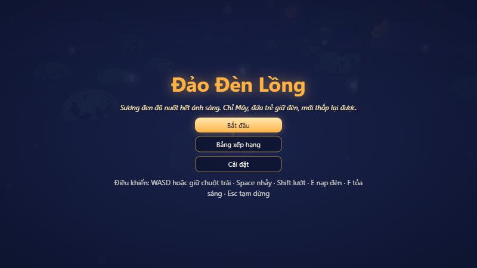
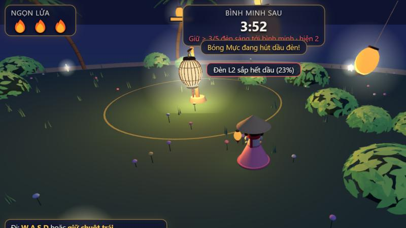
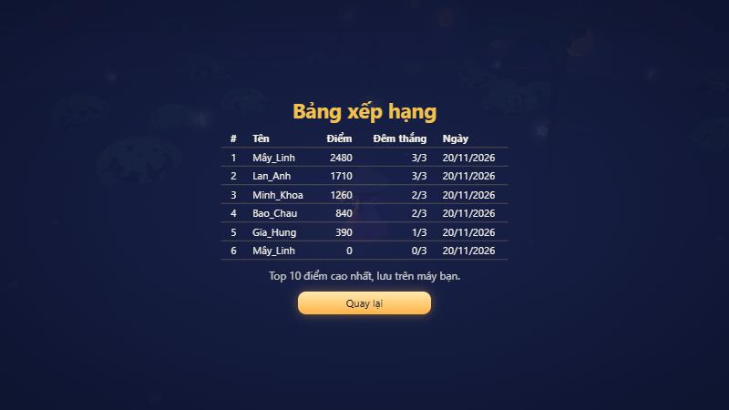

# Đảo Đèn Lồng

> **Video demo (4 phút 18 giây):** [demo.mp4 trong Release v1.0.0](https://github.com/vugialinh905-wq/K5-L3A-DAY12-VuGiaLinh-2A202603677-AI-SDLC-Dao-Den-Long/releases/download/v1.0.0/demo.mp4) · kịch bản quay: [docs/demo/DEMO.md](docs/demo/DEMO.md)





Game 3D góc nhìn thứ ba. **Mây**, người giữ đèn nhỏ tuổi, gom đom đóm, thắp các Đèn Lồng Lớn và **giữ chúng sáng tới bình minh** qua 3 Đêm: Đảo Bến (5 đèn, 240 s), Đảo Cau (2 đảo nối bằng cầu tre, bục nhảy, 6 đèn, 270 s) và Đảo Chuông (3 tầng, dốc, gió mạnh, 7 đèn, 300 s). Đèn có nhiên liệu và có thể tắt; Bóng Mực hút dầu những đèn yếu; Gió Lạc cuỗm đom đóm. Thắng một Đêm khi còn sống lúc bình minh và còn ít nhất 60% số đèn sáng (3/5, 4/6, 5/7).

## Yêu cầu hệ thống
- **Node.js ≥ 18** (đã thử trên Node 24, Windows 11). Chạy được trên macOS/Linux vì chỉ dùng Node thuần và trình duyệt.
- Trình duyệt hiện đại có **WebGL2** (Chrome, Edge, Firefox, Safari). Không cần mạng: Three.js 0.160.0 nằm sẵn trong `vendor/`.
- Benchmark cần Chrome, Edge hoặc Chromium (tự dò đường dẫn; hoặc đặt `BENCH_BROWSER`, hoặc dùng `--manual`).
- Máy gợi ý: GPU tích hợp trở lên, 4 GB RAM. Máy tác giả (Intel Iris Xe) đạt 98.6 FPS ở cảnh benchmark.

## Cài đặt và chạy (3 lệnh)

```bash
git clone https://github.com/vugialinh905-wq/K5-L3A-DAY12-VuGiaLinh-2A202603677-AI-SDLC-Dao-Den-Long.git && cd K5-L3A-DAY12-VuGiaLinh-2A202603677-AI-SDLC-Dao-Den-Long
npm install      # không có phụ thuộc, chỉ để khớp build_cmd
node serve.js    # rồi mở http://localhost:8080
```

Đường tắt thử nhanh một Đêm: `http://localhost:8080/?night=2`. Bản **Release v1.0.0** là thư mục web tĩnh (`dao-den-long-v1.0.0-web.zip`): giải nén rồi chạy `node serve.js`.

## Điều khiển (đổi được trong Cài đặt)

| Phím mặc định | Hành động |
|---|---|
| Giữ chuột trái | Đi về phía con trỏ |
| W A S D | Đi lên / trái / xuống / phải |
| Space | Nhảy (chỉ khi chạm đất) |
| Shift | Lướt 14 m/s trong 0.2 s, hồi 1.5 s |
| E | Gần đèn (≤ 2 m): đèn tắt thì nạp để thắp (10 đom đóm, thắp lại 5); đèn sáng thì châm dầu (+10 dầu mỗi đom đóm) |
| F | Tỏa Sáng: tốn 3 đom đóm, choáng và đẩy lùi Bóng Mực trong 5 m, hồi 3 s |
| Esc | Tạm dừng (Tiếp tục / Chơi lại Đêm / Cài đặt / Về menu) |
| ← → hoặc Z C, chuột phải kéo | Xoay camera (cố định) |
| P, H | Tạm dừng phụ, hiện/ẩn trợ giúp (cố định) |

**Luật chính:** đèn mới thắp có 100 dầu, hao 1/giây; dưới 30 thì nhấp nháy, mất vùng an toàn và thu hút Bóng Mực tới hút 5/giây. Hết dầu đèn tắt nhưng nhớ đã từng sáng. Sức chứa đom đóm = 10 + 2 × số lần thắp thành công (tối đa 20). Điểm: +5 mỗi đom đóm nạp/châm, +100 thắp lần đầu, +40 thắp lại, +5 mỗi Bóng Mực trúng Tỏa Sáng (+15 nếu đang hút dầu); thắng thì thêm (50 + phần nguyên của dầu) mỗi đèn sáng và 50 mỗi ngọn lửa còn lại.

## Chọn đêm
Từ menu bấm **Chọn đêm** để chơi riêng Đêm 1, 2 hoặc 3 (thử nhanh một bản đồ hay luyện tay). Chế độ này không ghi vào bảng xếp hạng; chơi xong có thể chơi lại đêm đó hoặc chọn đêm khác. **Bắt đầu** vẫn là 3 đêm liên tiếp, có tổng điểm, màn Bình Minh và bảng xếp hạng.

## Bảng xếp hạng
Sau màn Bình Minh (thắng Đêm 3) hoặc sau khi thua ở bất kỳ Đêm nào, nhập tên (3–12 ký tự: chữ cái, có dấu được, số, `_`) để lưu điểm. Top 10, điểm giảm dần, bằng điểm thì ai đạt trước đứng trên. Lưu trên đĩa tại `data/leaderboard.json` (qua `serve.js`), còn nguyên khi tắt mở lại; xem từ menu chính. Xuất ra file:

```bash
node serve.js --export-leaderboard out.json    # {"entries": [ {name, score, nights_won, achieved_at, seed} ]}
```

## Dễ tiếp cận
Cài đặt có: **đổi phím** cho mọi hành động (báo trùng phím, "Khôi phục mặc định", được lưu) · **phụ đề / chỉ báo hình ảnh** (Bóng Mực xuất hiện kèm mũi tên ở mép màn hình, gió sắp thổi, 10 giây cuối, đèn dưới 30 dầu) · **giảm chuyển động** (tắt rung camera, chớp màn hình, lá bay; mặc định theo `prefers-reduced-motion`) · **chữ lớn ×1.25** (chữ UI tối thiểu 18 px ở 1280×720) · **bảng màu dễ phân biệt** (mù màu) · âm lượng và độ nhạy chuột.

## Chạy test, headless, benchmark, soak

```bash
npm test                                                    # 72 test
node src/headless.js --seed 1 --night 1 --ticks 600 --out out.jsonl   # headless (Contract v1.3); --night 1|2|3
node bench.js --seed 42 --duration 30 --out bench.json      # benchmark (mở Chrome/Edge)
node soak.js --seed 7 --nights 10 --out soak.json           # soak test 10 Đêm headless
```

**Benchmark.** Cảnh chuẩn: Đêm 1, cửa sổ 1280×720, vsync tắt (`--disable-frame-rate-limit --disable-gpu-vsync`), 200 Bóng Mực `wander` rải đều + 100 đom đóm + L1–L3 sáng fuel 100, Mây đứng yên tại (0,0,0), camera quay quanh bán kính 30 m, cao 15 m, 15 s/vòng, 3 s khởi động rồi đo. Trong cảnh này phần trang trí sáng tạo (bụi, cây, hoa, đèn giấy) được tắt. Kết quả tại máy tác giả ([bench.json](bench.json)): **98.6 FPS trung bình · p1 low 41.7 FPS · p95 14.1 ms · tải 1282 ms** (ANGLE (Intel, Intel(R) Iris(R) Xe Graphics (0x00009A49) Direct3D11 vs_5_0 ps_5_0, D3D11)). `peak_mem_mb` là tổng working set của mọi tiến trình trình duyệt (có tính trùng bộ nhớ dùng chung). Nếu không có trình duyệt Chromium: `node bench.js --manual` in địa chỉ để tự mở (khi đó `vsync_off` = false).

**Soak.** 10 Đêm liên tiếp trong một tiến trình, Đêm i dùng seed 7 + i (i = 1…10), input ngẫu nhiên theo seed. Kết quả ([soak.json](soak.json)): **0 lỗi, bộ nhớ 49.3 → 51.3 MB** (ngưỡng ≤ 1.2×), tổng 0.4 s. `mem_start_mb` đo sau khi tải và làm nóng JIT cho Đêm đầu (xem [ghi chú](docs/notes/phase-4.md)); `heap_*_mb` chứng minh không rò rỉ.

## Cấu trúc
- `src/core.js` — lõi luật chơi thuần (không DOM/GPU), 3 bản đồ chuẩn, cảnh benchmark.
- `src/headless.js`, `soak.js`, `bench.js`, `serve.js` — các lệnh của contract (`game.contract.json`, phiên bản 1.3).
- `src/main.js`, `src/world.js`, `src/audio.js`, `index.html` — hiển thị 3D, âm thanh, menu, HUD. `src/bindings.js`, `src/leaderboard.js`, `src/server.js`, `src/benchstats.js` — đổi phím, bảng xếp hạng, server tĩnh + API, thống kê benchmark.
- `tests/` — test headless, bảng xếp hạng, đổi phím, benchmark, soak.
- `docs/` — ADR, spec, giả định, bằng chứng từng phase, retro, kịch bản demo. [CHANGELOG.md](CHANGELOG.md), [CREDITS.md](CREDITS.md), [LICENSE](LICENSE).
- `AGENTS.md`, `.claude/skills/` — harness cho agent AI.

## Sáng tạo của tôi
Chỉ nằm ở lớp hiển thị và tiện ích; luật và đầu ra headless không đổi. Điều khiển bằng chuột; Mây váy hồng, áo kem, khăn đỏ, nón lá có đèn lồng nhỏ; đèn lồng khung sườn có tua; đom đóm hình sao; bụi cây vẽ phẳng có hoa vàng, nấm đỏ chấm trắng, đá góc cạnh, cây dừa, cây cau, hoa, đèn giấy treo; lời Ông Đăng; tia tím nối Bóng Mực với đèn bị hút; tự tạm dừng khi rời tab. Các phần này tắt trong cảnh benchmark.

## Tài liệu theo phase
[ADR](docs/adr/) · Spec: [P2](docs/spec/phase-2.md) [P3](docs/spec/phase-3.md) [P4](docs/spec/phase-4.md) · Giả định: [P1](docs/notes/phase-1.md) [P2](docs/notes/phase-2.md) [P3](docs/notes/phase-3.md) [P4](docs/notes/phase-4.md) · Bằng chứng: [P1](docs/proof/phase-1.md) [P2](docs/proof/phase-2.md) [P3](docs/proof/phase-3.md) [P4](docs/proof/phase-4.md) · [Retro](docs/retro.md)

---

## Tài liệu của lab

| File | Nội dung |
|---|---|
| [GUIDE.md](GUIDE.md) | Hướng dẫn làm lab: vòng làm việc mỗi phase, harness, kiểm chứng, token |
| [CHECKPOINTS.md](CHECKPOINTS.md) | Các mốc tự kiểm tra từ chuẩn bị đến nộp bài |
| [SUBMISSION.md](SUBMISSION.md) | Đặt tên repo, hạn nộp, tag, Release, video, checklist |
| [RULES.md](RULES.md) | Quy định: AI, trung thực về bằng chứng, bản quyền, bảo mật |
| [RUBRIC.md](RUBRIC.md) | Thang điểm chi tiết |

## Lab board

Yêu cầu dự án được phát hành tại **[Đảo Đèn Lồng Lab](https://claude.ai/artifact/Q1RYyv1dxjUczzCbd2ZnoW)**. Mỗi phase là một tab (tab chưa phát hành bị khóa), mỗi tab có trợ giảng AI riêng chỉ trả lời trong phạm vi phase đó. Trợ giảng cần đăng nhập claude.ai và dùng lượt Claude của bạn.

## Dự án

**Đảo Đèn Lồng**: game 3D góc nhìn thứ ba. Mây, người giữ đèn nhỏ tuổi, gom đom đóm để thắp lại các Đèn Lồng Lớn và né Bóng Mực trong sương đen.

- Không ràng buộc công nghệ; chạy được trên macOS hoặc Linux.
- Tuân theo **Test Contract** (chế độ headless) để được chấm tự động và so sánh với nhau.

| Phase | Bạn nhận | Nộp |
|---|---|---|
| 1 | **PRD-0** (mô tả tổng quát) + Test Contract | tag `phase-1` |
| 2 | **Ticket-02**, phát hành khi Phase 1 kết thúc | tag `phase-2` |
| 3 | **Ticket-03**, phát hành khi Phase 2 kết thúc | tag `phase-3` |
| 4 | **Ticket-04**, phát hành khi Phase 3 kết thúc | tag `phase-4` + Release `v1.0.0` |

Yêu cầu sẽ được bổ sung và có thể thay đổi giữa các phase, giống dự án thật.

### Lịch 4 giờ

Bài lab kéo dài **4 giờ**. Phase 1 và 2 khoảng **1 giờ**, Phase 3 khoảng **30 phút**, Phase 4 khoảng **1 giờ 30 phút**. Mỗi phase phát hành đúng mốc giờ. Phase mới xuất hiện trên lab board khi tới mốc.

| Mốc | Sự kiện | Hạn tag |
|---|---|---|
| 0h | Phát hành **Phase 1** (PRD-0), gồm cả phần chuẩn bị | `phase-1` trước mốc 1h |
| 1h | Phát hành **Phase 2** | `phase-2` trước mốc 2h |
| 2h | Phát hành **Phase 3** | `phase-3` trước mốc 2h30 |
| 2h30 | Phát hành **Phase 4** | `phase-4`, Release `v1.0.0` và video trước mốc 4h |
| 4h | Hết giờ lab, chốt bài | |

Hết giờ mỗi phase thì tag và chuyển sang phase tiếp theo, dù phase chưa hoàn hảo. Chỗ chưa xong ghi trung thực trong bằng chứng.

---

## Gợi ý SDLC (cách làm là của bạn)

Mỗi phase là một vòng nhỏ. Công cụ, thứ tự, định dạng tài liệu đều tự do; đây chỉ là gợi ý:

1. **Requirements:** biến yêu cầu thành tiêu chí nghiệm thu kiểm chứng được. Chỗ mơ hồ thì tự giả định và ghi lại.
2. **Plan:** nghĩ cách kiểm chứng **trước** khi để agent viết code.
3. **Build:** để agent viết, bạn điều phối và review.
4. **Verify:** chạy thật, kiểm tra hành vi thật. *Không có bằng chứng thì chưa xong*: "agent bảo chạy rồi" không phải bằng chứng.
5. **Evaluate:** cái gì đạt, AI sai ở đâu, harness (AGENTS.md, skill, hook) cần chỉnh gì.
6. **Release:** gắn tag.

## Ba điều cần nhớ

> Bạn được **tự do sáng tạo thêm** quanh phần lõi (nhân vật, cơ chế nhỏ, câu chuyện, hiệu ứng, âm thanh…). Sáng tạo gọn và không phá yêu cầu được tính điểm trong hạng mục F của [RUBRIC](RUBRIC.md); ghi mục "Sáng tạo của tôi" trong README của bạn.

- **Game tốt là game đúng yêu cầu của khách hàng**, không phải game phức tạp hay đẹp nhất. Làm đúng và chứng minh được là đúng trước, trau chuốt sau.
- **Cân nhắc kỹ quota token của bạn.** Đốt nhiều token không làm bài tốt hơn. Ngữ cảnh gọn, kế hoạch rõ, kiểm chứng sớm thường vừa rẻ vừa đúng hơn chạy agent liên tục.
- **Kiểm chứng là phần quan trọng nhất.** Bằng chứng (test, output headless, ảnh, số đo) đáng giá hơn lời mô tả.

---

## Bàn giao cuối cùng

Một **repo GitHub cá nhân, public**, gồm:

1. **Toàn bộ mã nguồn** của game qua 4 phase, tag `phase-1` … `phase-4`, Release `v1.0.0`.
2. **Video demo `.mp4` dưới 5 phút** (đính kèm Release `v1.0.0` hoặc `docs/demo/demo.mp4`, link ở đầu README): chơi thử và cho thấy bằng chứng game chạy đúng.
3. **Bằng chứng kiểm chứng** của từng phase (định dạng tự chọn).
4. **Harness AI đã dùng** (AGENTS.md / CLAUDE.md, skills, hooks, plugins…), giữ nguyên trong repo và lịch sử git.
5. **Ghi chép ngắn:** spec/giả định mỗi phase, nhật ký dùng AI (gồm token/chi phí ước tính), retro.

Không commit API key, token hay `.env`. Gửi link repo theo hướng dẫn của Coach.

## Đánh giá (100 điểm)

| Hạng mục | Điểm |
|---|---|
| Test tự động ẩn (headless, gồm kiểm tra lại phase trước) | 30 |
| Kiểm chứng & bằng chứng của bạn | 20 |
| Quy trình SDLC & harness AI | 15 |
| Evaluation & retro (gồm cách bạn dùng token) | 10 |
| Hiệu năng & ổn định | 10 |
| Chất lượng sản phẩm (đúng yêu cầu, chơi được) | 10 |
| Video demo | 5 |

## Quy định

- Dùng AI thoải mái; không sao chép repo của người khác.
- Bằng chứng phải thật: test luôn đạt hay output sửa tay là vi phạm.
- Nhân vật, bối cảnh là bản gốc của lab; asset bên ngoài chỉ dùng loại CC0/CC-BY/MIT hoặc tự tạo, ghi nguồn trong `CREDITS.md`.
